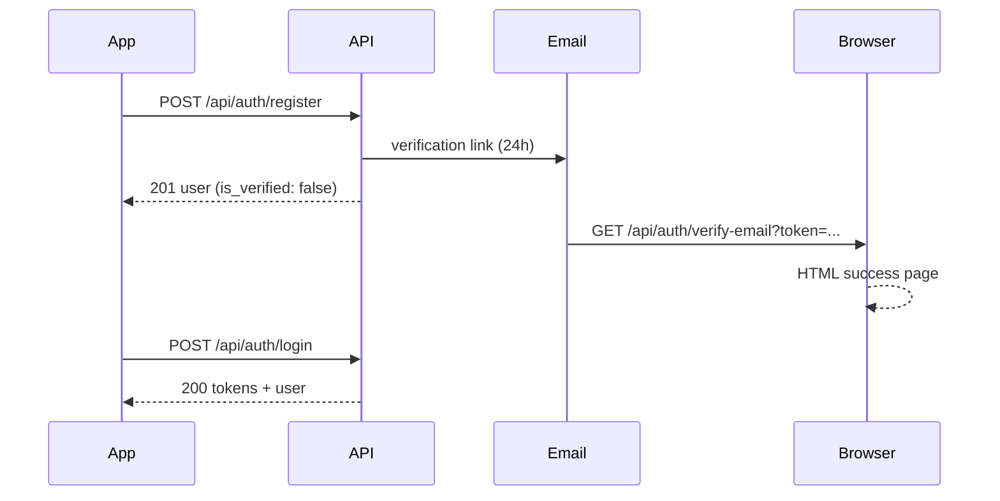

# Auth API

Registration, login, token refresh, logout, email verification, and password reset.

**Base path:** `/api/auth`  
See [README.md](./README.md) for base URL, error envelopes, and rate limits.

---

## Available endpoints

| Method | Path | Auth | Purpose |
|--------|------|------|---------|
| `POST` | `/api/auth/register` | No | Create account + send verification email |
| `POST` | `/api/auth/login` | No | Email/password login → JWT tokens |
| `POST` | `/api/auth/google` | No | Google ID token login/sign-up → JWT tokens — see [google-auth-api.md](./google-auth-api.md) |
| `POST` | `/api/auth/refresh` | No | Rotate refresh token; get new access token |
| `POST` | `/api/auth/logout` | **Yes** | Invalidate refresh token on server |
| `GET` | `/api/auth/me` | **Yes** | Current user + key settings (bootstrap) |
| `GET` | `/api/auth/verify-email` | No | Verify email from link (**HTML**, not JSON) |
| `POST` | `/api/auth/resend-verification` | No | Resend verification email |
| `POST` | `/api/auth/forgot-password` | No | Request password-reset email |
| `POST` | `/api/auth/reset-password` | No | Set new password with reset token |

---

## Token model

| Token | Env secret | Default lifetime | Storage (client) | Storage (server) |
|-------|------------|------------------|------------------|------------------|
| Access | `JWT_ACCESS_SECRET` | `JWT_ACCESS_EXPIRES` → **15m** | Memory / secure storage | Not stored (stateless JWT) |
| Refresh | `JWT_REFRESH_SECRET` | `JWT_REFRESH_EXPIRES` → **7d** | Secure persistent storage | Bcrypt hash in `User.refresh_token_hash` |

JWT payload (both tokens): `{ "userId": "<mongo_id>" }`.

### Protected requests

```http
Authorization: Bearer <access_token>
Content-Type: application/json
```

### Refresh rotation

Every successful `POST /api/auth/refresh` returns a **new** `access_token` **and** a **new** `refresh_token`. Replace the stored refresh token immediately; the old one no longer validates.

### Session invalidation

Refresh tokens are cleared (user must log in again) when:

- `POST /api/auth/logout` (current device)
- `POST /api/auth/reset-password` (all devices)
- Refresh hash missing or mismatch on refresh (e.g. logged in elsewhere after rotation, or admin cleared session)

Access tokens remain valid until they expire (~15m) even after logout; do not use a logged-out access token for new requests.

---

## Auth user object (`data.user`)

Returned by `register`, `login`, and `me` (same slim shape).

| Field | Type | Notes |
|-------|------|-------|
| `_id` | `string` | MongoDB user id |
| `name` | `string` | Display name |
| `username` | `string` | Lowercase handle |
| `email` | `string` | Lowercase email |
| `is_verified` | `boolean` | `true` after email verification |
| `profile_picture` | `string \| null` | Cloudinary URL or `null` |

For the full profile screen (including editable timezone), use [`GET /api/profile`](./profile-api.md).

---

## Settings on `GET /api/auth/me` (`data.settings`)

Subset of user settings for app bootstrap (theme, notifications). `null` if no settings document exists (should not happen after register).

| Field | Type | Notes |
|-------|------|-------|
| `theme` | `string` | `dark` \| `light` \| `system` (default `system`) |
| `notifications_enabled` | `boolean` | Master notification toggle |
| `push_notifications_enabled` | `boolean` | Push channel |
| `email_notifications_enabled` | `boolean` | Email channel |
| `quiet_hours_enabled` | `boolean` | Quiet hours master toggle |
| `quiet_hours` | `array` | `{ start, end }` blocks — see [settings-api.md](./settings-api.md) |
| `allow_friend_requests` | `boolean` | Whether others can send friend requests |

---

## UX flows

### Sign up → verify → login



1. `POST /api/auth/register` → show “check your email”.
2. User opens email link → browser hits `GET /api/auth/verify-email?token=...` (HTML page).
3. `POST /api/auth/login` → store `access_token` + `refresh_token`.
4. Optional bootstrap: `GET /api/auth/me` for user + settings.
5. Register push token: `PATCH /api/settings` with `push_token` — see [push-notifications-frontend-setup.md](./push-notifications-frontend-setup.md).

### Session restore

1. If access token expired → `POST /api/auth/refresh` with stored `refresh_token`.
2. On `401` from refresh → clear tokens and show login.
3. `GET /api/auth/me` to hydrate user + settings.

### Logout

1. `POST /api/auth/logout` with valid access token (clears server refresh hash).
2. Clear local tokens.
3. Optional: `PATCH /api/settings` with `remove_push_token` for this device — see [settings-api.md](./settings-api.md).

### Forgot password

1. `POST /api/auth/forgot-password` with email.
2. User opens email link — **should land on your app’s reset screen** (set `RESET_PASSWORD_URL` in backend `.env`).
3. App reads `token` from URL/deep link → `POST /api/auth/reset-password`.
4. User logs in with new password.

---

## `POST /api/auth/register`

Create a local (`auth_provider: local`) account. Does **not** return tokens; user must verify email before login.

| | |
|---|---|
| **Auth** | No |
| **Content-Type** | `application/json` |

### Request body

| Field | Type | Required | Validation |
|-------|------|----------|------------|
| `name` | `string` | Yes | Max 100 chars |
| `username` | `string` | Yes | 3–30 chars; `[a-z0-9_]`; stored lowercase; unique |
| `email` | `string` | Yes | Valid email format; stored lowercase; unique |
| `password` | `string` | Yes | Min 6 characters |
| `timezone` | `string` | No | IANA timezone; default `"Asia/Karachi"` if omitted/invalid |

### Success `201`

```json
{
  "status": "success",
  "message": "Registration successful. Please check your email to verify your account.",
  "data": {
    "user": {
      "_id": "674a1b2c3d4e5f6789012301",
      "name": "Hamid",
      "username": "hamid",
      "email": "hamid@example.com",
      "is_verified": false,
      "profile_picture": null
    },
    "email_sent": true
  }
}
```

`email_sent: false` when SMTP fails; account is still created. Message text changes to mention verifying before login.

### Side effects

- Creates default `UserSetting` for the user.
- Stores SHA-256 hash of verification token (24h expiry); plain token only in email.
- Sends verification email — link format below.

### Errors

| Status | When |
|--------|------|
| `400` | Missing `name`, `username`, `email`, or `password` |
| `409` | `Email already registered` |
| `409` | `Username already taken` |
| `422` | Mongoose validation (invalid email format, username pattern, etc.) |

---

## `POST /api/auth/login`

| | |
|---|---|
| **Auth** | No |
| **Content-Type** | `application/json` |

### Request body

| Field | Type | Required |
|-------|------|----------|
| `email` | `string` | Yes |
| `password` | `string` | Yes |

Email is matched case-insensitively.

### Success `200`

```json
{
  "status": "success",
  "message": "Login successful",
  "data": {
    "user": {
      "_id": "674a1b2c3d4e5f6789012301",
      "name": "Hamid",
      "username": "hamid",
      "email": "hamid@example.com",
      "is_verified": true,
      "profile_picture": null
    },
    "tokens": {
      "access_token": "eyJhbGciOiJIUzI1NiIs...",
      "refresh_token": "eyJhbGciOiJIUzI1NiIs..."
    }
  }
}
```

### Errors

| Status | Message (typical) |
|--------|-------------------|
| `400` | `Email and password are required` |
| `401` | `Invalid email or password` |
| `401` | `Account is deactivated` |
| `401` | `Please verify your email before logging in` |
| `401` | `Please login with Google` (Google-only account, no local password) |

---

## `POST /api/auth/google`

Google Sign-In / sign-up with a Google **ID token** from the client.

**Full reference:** [google-auth-api.md](./google-auth-api.md) (flow, examples, frontend notes, env vars).

| | |
|---|---|
| **Auth** | No |
| **Content-Type** | `application/json` |

### Request body

| Field | Type | Required |
|-------|------|----------|
| `id_token` | `string` | Yes |
| `timezone` | `string` | No (new users; default `Asia/Karachi`) |

### Success

- **`200`** — existing Google user login  
- **`201`** — new Google user; `data.is_new_user: true`  
- Same `data.user` + `data.tokens` envelope as login

### Errors (typical)

| Status | Message |
|--------|---------|
| `400` | `id_token is required` |
| `401` | `Invalid Google sign-in token` |
| `409` | Email registered with password — use email login |

---

## `POST /api/auth/refresh`

| | |
|---|---|
| **Auth** | No (uses refresh token in body) |
| **Content-Type** | `application/json` |

### Request body

```json
{
  "refresh_token": "eyJhbGciOiJIUzI1NiIs..."
}
```

### Success `200`

```json
{
  "status": "success",
  "message": "Token refreshed",
  "data": {
    "tokens": {
      "access_token": "eyJhbGciOiJIUzI1NiIs...",
      "refresh_token": "eyJhbGciOiJIUzI1NiIs..."
    }
  }
}
```

No `user` object — use `GET /api/auth/me` if needed.

### Errors

| Status | Message (typical) |
|--------|-------------------|
| `400` | `Refresh token is required` |
| `401` | `Refresh token expired. Please login again` |
| `401` | `Invalid refresh token` |
| `401` | `User not found` |
| `401` | `Account is deactivated` |
| `401` | `Refresh token invalidated. Please login again` |
| `401` | `Invalid refresh token. Please login again` |

---

## `POST /api/auth/logout`

Invalidate the server-side refresh token for the current user.

| | |
|---|---|
| **Auth** | Required (`Bearer` access token) |
| **Request body** | None |

### Success `200`

```json
{
  "status": "success",
  "message": "Logged out successfully"
}
```

### Errors

| Status | When |
|--------|------|
| `401` | Missing, expired, or invalid access token |
| `401` | User deactivated or deleted |

---

## `GET /api/auth/me`

Bootstrap endpoint after login or token refresh.

| | |
|---|---|
| **Auth** | Required |
| **Request body** | None |

### Success `200`

```json
{
  "status": "success",
  "data": {
    "user": {
      "_id": "674a1b2c3d4e5f6789012301",
      "name": "Hamid",
      "username": "hamid",
      "email": "hamid@example.com",
      "is_verified": true,
      "profile_picture": "https://res.cloudinary.com/..."
    },
    "settings": {
      "theme": "system",
      "notifications_enabled": true,
      "push_notifications_enabled": true,
      "email_notifications_enabled": false,
      "quiet_hours_enabled": false,
      "quiet_hours": [],
      "allow_friend_requests": true
    }
  }
}
```

### Errors

| Status | When |
|--------|------|
| `401` | `Access token required` / expired / invalid |
| `401` | User no longer exists or deactivated |

### vs `GET /api/profile`

| | `GET /api/auth/me` | `GET /api/profile` |
|--|-------------------|-------------------|
| User fields | Slim auth shape | Full profile + `timezone` |
| Settings | Yes | No |
| Use when | Splash, session restore, theme init | Profile / Edit Profile screen |

---

## `GET /api/auth/verify-email`

Browser link from verification email. Returns **HTML**, not JSON — do not call from `fetch` expecting JSON.

| | |
|---|---|
| **Auth** | No |
| **Query** | `token` (required) — plain hex token from email |

### Example URL

```
GET /api/auth/verify-email?token=<64-char-hex>
```

Built by backend as:

- `VERIFY_EMAIL_URL` if set (may include `{token}` placeholder), else
- `{BACKEND_PUBLIC_URL or http://localhost:BACKEND_PORT}/api/auth/verify-email?token=...`

### Responses (HTML pages)

| Status | Page | Meaning |
|--------|------|---------|
| `200` | Green “Email verified” | `is_verified` set to `true`; token fields cleared |
| `400` | Red “Verification failed” | Missing `token` query param |
| `400` | Red “Link expired or invalid” | Wrong token, expired (>24h), or already used |
| `500` | Red “Something went wrong” | Server error |

After success, user can return to the app and log in.

---

## `POST /api/auth/resend-verification`

| | |
|---|---|
| **Auth** | No |
| **Content-Type** | `application/json` |

### Request body

```json
{
  "email": "hamid@example.com"
}
```

### Success `200`

Always the same message (anti-enumeration):

```json
{
  "status": "success",
  "message": "If an account exists with this email, a verification link has been sent."
}
```

If account exists and is unverified, a new 24h token is generated and emailed.

### Errors

| Status | When |
|--------|------|
| `400` | `Email is required` |
| `400` | `Email is already verified` |

---

## `POST /api/auth/forgot-password`

| | |
|---|---|
| **Auth** | No |
| **Content-Type** | `application/json` |

### Request body

```json
{
  "email": "hamid@example.com"
}
```

### Success `200`

Always generic (anti-enumeration):

```json
{
  "status": "success",
  "message": "If an account exists with this email, a password reset link has been sent."
}
```

Email is only sent when the account exists, is **active**, and has a **local password** (`password_hash`). Google-only accounts get the same `200` with no email.

Reset token expires in **1 hour**.

### Errors

| Status | When |
|--------|------|
| `400` | `Email is required` |

---

## `POST /api/auth/reset-password`

| | |
|---|---|
| **Auth** | No |
| **Content-Type** | `application/json` |

### Request body

| Field | Type | Required | Validation |
|-------|------|----------|------------|
| `token` | `string` | Yes | Plain token from reset email / deep link |
| `new_password` | `string` | Yes | Min 6 characters |
| `confirm_password` | `string` | Yes | Must equal `new_password` |

### Success `200`

```json
{
  "status": "success",
  "message": "Password reset successful. Please login with your new password."
}
```

Clears `password_reset_token`, `password_reset_expires`, and **`refresh_token_hash`** (all sessions logged out).

### Errors

| Status | When |
|--------|------|
| `400` | `token, new_password, and confirm_password are required` |
| `400` | `Password must be at least 6 characters` |
| `400` | `new_password and confirm_password do not match` |
| `400` | `Invalid or expired reset token` |

### Email link vs this endpoint

The reset **email** link is built with `RESET_PASSWORD_URL` or defaults to  
`{backend}/api/auth/reset-password?token=...`. There is **no GET handler** on that path — configure `RESET_PASSWORD_URL` to your **mobile/web reset screen** (e.g. `https://app.example.com/reset?token={token}` or a custom scheme). The app then calls this `POST` with the token and new password.

---

## Environment variables (auth-related)

| Variable | Purpose |
|----------|---------|
| `JWT_ACCESS_SECRET` | Sign access tokens |
| `JWT_REFRESH_SECRET` | Sign refresh tokens |
| `JWT_ACCESS_EXPIRES` | Access TTL (default `15m`) |
| `JWT_REFRESH_EXPIRES` | Refresh TTL (default `7d`) |
| `EMAIL_HOST`, `EMAIL_PORT`, `EMAIL_USER`, `EMAIL_PASS` | SMTP for verification / reset emails |
| `BACKEND_PORT` | Server port (default `3000`) |
| `BACKEND_PUBLIC_URL` | Base URL for email links when template envs unset |
| `VERIFY_EMAIL_URL` | Optional override for verification link (`{token}` supported) |
| `RESET_PASSWORD_URL` | Optional override for reset link — **should point to frontend** (`{token}` supported) |

---

## Related APIs

| Need | Endpoint | Doc |
|------|----------|-----|
| Full profile + edit | `GET` / `PATCH /api/profile` | [profile-api.md](./profile-api.md) |
| Theme / notifications / push token | `GET` / `PATCH /api/settings` | [settings-api.md](./settings-api.md) |
| Google sign-in | Integrations (separate flow) | [google-auth-api.md](./google-auth-api.md) |

---

## Quick reference — HTTP status codes

| Code | Typical auth cause |
|------|-------------------|
| `201` | Register success |
| `200` | Login, refresh, logout, me, resend, forgot, reset |
| `400` | Validation / missing fields / bad reset token |
| `401` | Bad credentials, unverified email, token errors |
| `409` | Duplicate email or username on register |
| `422` | Mongoose schema validation on register |
| `429` | Global API rate limit (100 req / 15 min / IP on `/api/*`) |
