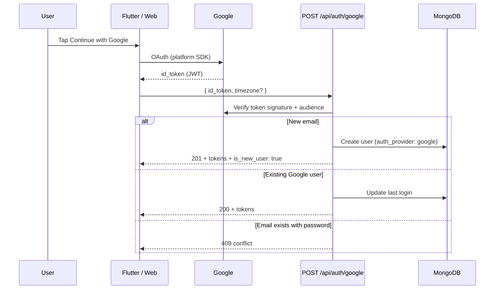

# Google Sign-In API

Backend endpoint for **Google OAuth sign-in / sign-up**. The client (Flutter or Web) obtains a Google **ID token**; the backend verifies it, creates or loads the user, and returns EVA JWT tokens — same session model as email/password login.

**Endpoint:** `POST /api/auth/google`  
**Base path:** `/api/auth`  
See [README.md](./README.md) for base URL, error envelopes, and token storage.  
Related: [auth-api.md](./auth-api.md) (email login, refresh, logout).

---

## Endpoints

| Method | Path | Auth | Purpose |
|--------|------|------|---------|
| `POST` | `/api/auth/google` | No | Verify Google ID token → login or register → JWT tokens |

After success, use tokens exactly like email login: store `access_token` + `refresh_token`, call `GET /api/auth/me` for bootstrap, `POST /api/auth/refresh` when access expires, `POST /api/auth/logout` on sign-out.

---

## Flow (client → backend)



---

## `POST /api/auth/google`

| | |
|---|---|
| **Auth** | No |
| **Method** | `POST` |
| **Path** | `/api/auth/google` |
| **Content-Type** | `application/json` |

### Request body

| Field | Type | Required | Notes |
|-------|------|----------|-------|
| `id_token` | `string` | **Yes** | JWT from Google Sign-In (not access token) |
| `timezone` | `string` | No | IANA timezone for **new users only**; defaults to `Asia/Karachi` |

Example:

```json
{
  "id_token": "eyJhbGciOiJSUzI1NiIsImtpZCI6...",
  "timezone": "Asia/Karachi"
}
```

### Success `200` — existing Google user (login)

```json
{
  "status": "success",
  "message": "Google login successful",
  "data": {
    "user": {
      "_id": "674a1b2c3d4e5f6789012301",
      "name": "Hamid Shehzad",
      "username": "hamid_shehzad",
      "email": "hamid@example.com",
      "is_verified": true,
      "profile_picture": "https://lh3.googleusercontent.com/..."
    },
    "tokens": {
      "access_token": "eyJhbGciOiJIUzI1NiIs...",
      "refresh_token": "eyJhbGciOiJIUzI1NiIs..."
    },
    "is_new_user": false
  }
}
```

### Success `201` — new Google user (sign-up)

Same shape as `200`, with:

- HTTP status **`201`**
- `"message": "Google sign-up successful"`
- `"data.is_new_user": true`

### User creation rules (new accounts)

| Field | Value |
|-------|--------|
| `auth_provider` | `"google"` |
| `is_verified` | `true` (Google already verified email) |
| `password_hash` | not set |
| `username` | auto-generated from email local-part; suffix added if taken (`hamid`, `hamid_1`, …) |
| `name` | from Google profile, or username fallback |
| `profile_picture` | Google photo URL when provided |
| `timezone` | from request body or `Asia/Karachi` |
| Settings | default `UserSetting` document created (same as `POST /api/auth/register`) |

No verification email is sent for Google sign-up.

### Existing account behavior

| Existing account | Result |
|------------------|--------|
| Same email, `auth_provider: "google"` | Login → `200` + tokens |
| Same email, local account **with password** | **`409`** — must use email/password login |
| Same email, local account without password | Upgraded to Google login |
| Deactivated account | **`401`** `Account is deactivated` |

### Errors

| Status | Message (typical) | Client action |
|--------|-------------------|---------------|
| `400` | `id_token is required` | Send non-empty `id_token` |
| `401` | `Invalid Google sign-in token` | Token expired, wrong audience, or backend `GOOGLE_CLIENT_ID` mismatch |
| `401` | `Google account email is unavailable` | User must grant email scope |
| `401` | `Google email is not verified` | Use a verified Google account |
| `401` | `Account is deactivated` | Show support / contact message |
| `409` | `This email is registered with a password...` | Route to email/password login |

---

## Auth user object (`data.user`)

Same slim shape as [auth-api.md](./auth-api.md#auth-user-object-datauser):

| Field | Type | Notes |
|-------|------|-------|
| `_id` | `string` | MongoDB user id |
| `name` | `string` | Display name |
| `username` | `string` | Auto-generated on Google sign-up |
| `email` | `string` | From Google |
| `is_verified` | `boolean` | Always `true` for Google users |
| `profile_picture` | `string \| null` | Google avatar URL or `null` |

---

## Token model

Identical to email login — see [auth-api.md](./auth-api.md#token-model):

| Token | Client storage | Server |
|-------|----------------|--------|
| `access_token` | Memory / secure storage | Stateless JWT (~15m) |
| `refresh_token` | Secure persistent storage | Bcrypt hash on user |

Use `Authorization: Bearer <access_token>` on protected routes.

---

## Frontend integration (reference)

Backend only verifies `id_token`. Clients must integrate Google OAuth separately.

### Web

1. Google Cloud **Web application** OAuth client.
2. Authorized JavaScript origin: e.g. `http://localhost:5173`.
3. Use Google Identity Services (e.g. `@react-oauth/google`) to get `credential` (ID token).
4. `POST /api/auth/google` with `{ "id_token": credential }`.

### Flutter (Android)

1. Google Cloud **Android** OAuth client: package name + SHA-1 fingerprint(s).
2. Use `google_sign_in` with **`serverClientId`** = **Web client ID** (so `id_token` audience matches backend).
3. `POST /api/auth/google` with `{ "id_token": "<from GoogleSignInAccount>" }`.

### What **not** to send

| Do not send | Reason |
|-------------|--------|
| Android OAuth client ID as `id_token` | Must be the JWT ID token |
| Google `access_token` only | Backend expects `id_token` |
| `GOOGLE_CLIENT_SECRET` from client | Server secret only |

---

## Backend configuration (ops / backend dev)

Add to `Eva_Backend_Server/.env`:

```env
GOOGLE_CLIENT_ID=your-web-oauth-client-id.apps.googleusercontent.com
```

Optional (if verifying Android-issued tokens without `serverClientId`):

```env
GOOGLE_ANDROID_CLIENT_ID=your-android-oauth-client-id.apps.googleusercontent.com
```

`GOOGLE_CLIENT_SECRET` is used for **Google Calendar** token refresh, not for this endpoint.

Restart the backend after changing env vars.

---

## Related endpoints

| Action | Endpoint |
|--------|----------|
| Email/password login | `POST /api/auth/login` |
| Refresh session | `POST /api/auth/refresh` |
| Logout | `POST /api/auth/logout` |
| Bootstrap after login | `GET /api/auth/me` |
| Google Calendar (separate) | `POST /api/integrations/google/connect` |

Google Sign-In **login** and Google Calendar **sync** are different features. Calendar requires a logged-in user and stores calendar tokens via the integrations API.

---

## Example `curl`

```bash
curl -X POST "http://localhost:4500/api/auth/google" \
  -H "Content-Type: application/json" \
  -d "{\"id_token\":\"<paste-google-id-token>\",\"timezone\":\"Asia/Karachi\"}"
```

Replace `<paste-google-id-token>` with a real token from a client SDK (tokens expire quickly; do not hardcode in apps).
